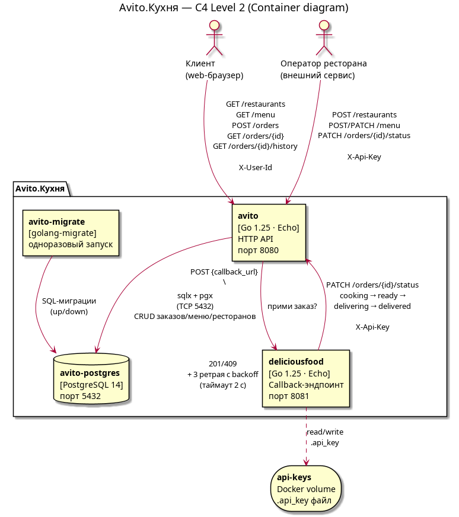
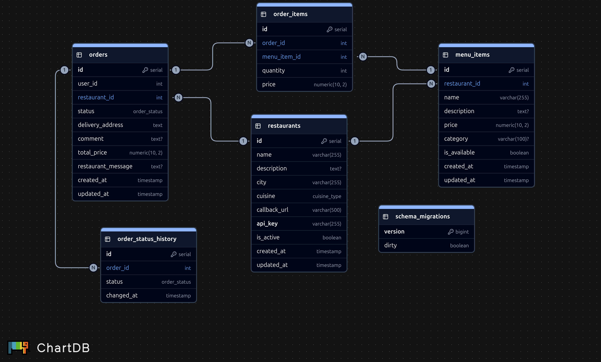
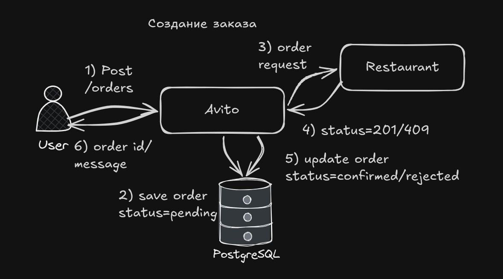
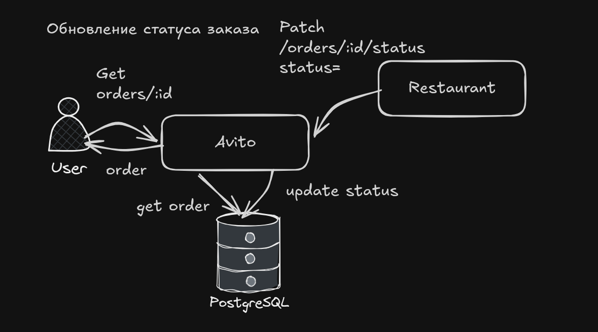
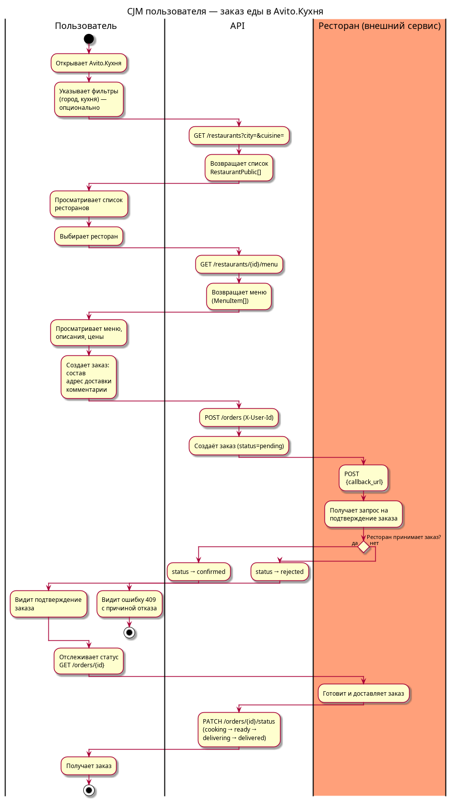
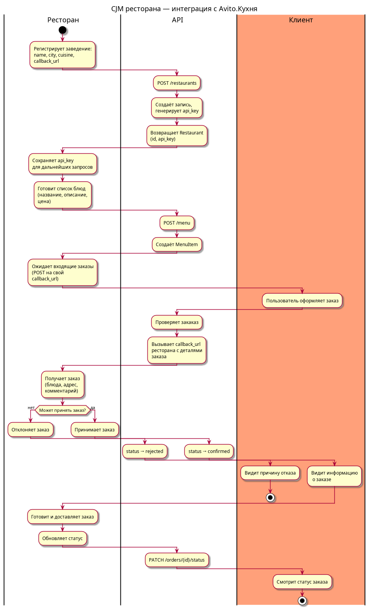

# Avito.Кухня

MVP backend-сервиса доставки еды: рестораны регистрируются, выкладывают меню
и принимают заказы пользователей через единый API платформы.

- Клиентский API — для web-клиента (`X-User-Id`).
- Партнёрский API — для заведений (`X-Api-Key`).

> Аутентификация пользователей и сам клиент по условиям задания **не реализуются**.

---

## Содержание

- [Avito.Кухня](#avitoкухня)
  - [Содержание](#содержание)
  - [Стек](#стек)
  - [Структура репозитория](#структура-репозитория)
  - [Быстрый старт](#быстрый-старт)
  - [Архитектура (C4 L2)](#архитектура-c4-l2)
  - [API](#api)
  - [Схема БД](#схема-бд)
  - [Жизненный цикл заказа](#жизненный-цикл-заказа)
    - [Создание](#создание)
    - [Обновление статуса](#обновление-статуса)
  - [CJM](#cjm)
    - [Сценарий пользователя](#сценарий-пользователя)
    - [Сценарий ресторана](#сценарий-ресторана)
  - [Упрощения MVP](#упрощения-mvp)
  - [Возможные улучшения:](#возможные-улучшения)
  - [Линтеры](#линтеры)

---

## Стек

- Go 1.25: echo, sqlx, pgx, golang-migrate
- PostgreSQL 14

## Структура репозитория

- `avito/` — основной сервис (HTTP API + миграции)
- `deliciousfood/` — пример ресторана-партнёра
- `config/.env.dev` — переменные окружения для dev
- `docker-compose.dev.yml` — оркестрация
- `docs/` — CJM-диаграммы (PUML + PNG)
- `Makefile` — `up` / `down` / `logs` / `ps` / `build` / `clean`
- OpenAPI: [`avito/api/openapi.yaml`](./avito/api/openapi.yaml)
- Линтер: [`avito/.golangci.yml`](./avito/.golangci.yml)

## Быстрый старт

```bash
make up        # postgres + миграции + avito + deliciousfood
make logs      # логи всех контейнеров
make down      # остановить (с сохранением данных)
make clean     # остановить и удалить volumes
```

После `make up`:

- **Avito.Кухня** — `http://localhost:8080`
- **deliciousfood** — `http://localhost:8081`
- **Postgres** — `localhost:5432` (`postgres/postgres`, db `avito`)

Подробный пример end-to-end сценария через `curl` — в
[`avito/api/openapi.yaml`](./avito/api/openapi.yaml) (вступительная часть
`description`).

## Архитектура (C4 L2)



Исходник: [`docs/architecture.puml`](./docs/architecture.puml).
Рендер: `plantuml docs/architecture.puml -t png -o docs`.

**Слои внутри `avito`:** `transport` (Echo) → `service` (бизнес-логика) →
`repository` (sqlx) → Postgres. Внутри также `pkg/restaurantapi` — HTTP-клиент
для синхронных callback'ов к ресторанам с ретраями и таймаутом.

## API

Полная спецификация — [`avito/api/openapi.yaml`](./avito/api/openapi.yaml).

| Метод & путь | Кто вызывает | Auth |
| --- | --- | --- |
| `GET /restaurants` | клиент | — |
| `POST /restaurants` | ресторан (регистрация) | — |
| `GET /restaurants/{id}` | клиент | — |
| `PATCH /restaurants/{id}` | ресторан | `X-Api-Key` |
| `GET /restaurants/{id}/menu` | клиент | — |
| `POST /menu` | ресторан | `X-Api-Key` |
| `PATCH /menu/{id}` | ресторан | `X-Api-Key` |
| `POST /orders` | клиент | `X-User-Id` |
| `GET /orders` | клиент | `X-User-Id` |
| `GET /orders/{id}` | клиент | `X-User-Id` |
| `GET /orders/{id}/history` | клиент | `X-User-Id` |
| `PATCH /orders/{id}/status` | ресторан | `X-Api-Key` |
| `GET /health` | мониторинг | — |

Все ошибки возвращаются в формате `{ "status": "error", "message": "..." }`,
коды: `400 / 401 / 403 / 404 / 409 / 500`.

## Схема БД



Исходник миграций — [`avito/migrations/`](./avito/migrations) (5 файлов
`*.up.sql` / `*.down.sql`).

Ключевые решения:

- Цена в `order_items` — **снапшот** цены из `menu_items` на момент заказа.
- История статусов (`order_status_history`) ведётся **триггером** PostgreSQL
  `update_order_status_history_trigger` — любой INSERT/UPDATE в `orders`
  автоматически порождает запись в истории (аудит без логики в коде).

## Жизненный цикл заказа

### Создание



### Обновление статуса



| Статус | Кто выставляет | Через что |
| --- | --- | --- |
| `pending` | Avito | автоматически при `POST /orders` |
| `confirmed` / `rejected` | Avito | по ответу ресторана на callback |
| `cooking` / `ready` / `delivering` / `delivered` | ресторан | `PATCH /orders/{id}/status` |

Запрещено менять `pending` (его ставит только API) и заказы в финальных
статусах (`rejected`, `delivered`). Валидация порядка переходов между
нефинальными статусами в MVP не выполняется — ресторан считается доверенным.

## CJM

Исходники: [`docs/user.puml`](./docs/user.puml),
[`docs/restaurant.puml`](./docs/restaurant.puml).

Текстовые описания — [`docs/user_flow.txt`](./docs/user_flow.txt),
[`docs/restaurant_flow.txt`](./docs/restaurant_flow.txt).

### Сценарий пользователя


### Сценарий ресторана


## Упрощения MVP

- `X-User-Id` вместо полноценной auth пользователей.
- API-ключ ресторана хранится в открытом виде в БД.
- Нет rate-limit / circuit breaker на callback к ресторану; есть только
  3 ретрая с экспоненциальным backoff и таймаутом 2 c.
- `deliciousfood` рандомно отклоняет 50% заказов — чтобы в демо были видны
  оба сценария CJM.
- Нет валидации переходов между нефинальными статусами.
- Нет пагинации в списках.
- Логи в stdout через `log.Printf`.
- Нет юнит-/интеграционных тестов.
- `golangci.yml` настроен только для `avito`.

## Возможные улучшения: 
- JWT вместо `X-User-Id`
- Хэширование API-ключа ресторана
- Брокер сообщений для событий `order.status_changed` Prometheus + Grafana + Loki для мониторинга.

## Линтеры

`avito/.golangci.yml` включает `errcheck`, `govet`, `staticcheck`, `unused`,
`bodyclose`, `contextcheck`, `errorlint`, `errname`, `noctx`, `sqlclosecheck`,
`unconvert`, `unparam`, `misspell`, `gocritic`, `gosec`, `prealloc`,
`copyloopvar`, `dupl`, `goconst`. Форматтеры: `gofmt` + `goimports`.

```bash
cd avito && golangci-lint run ./...
```
